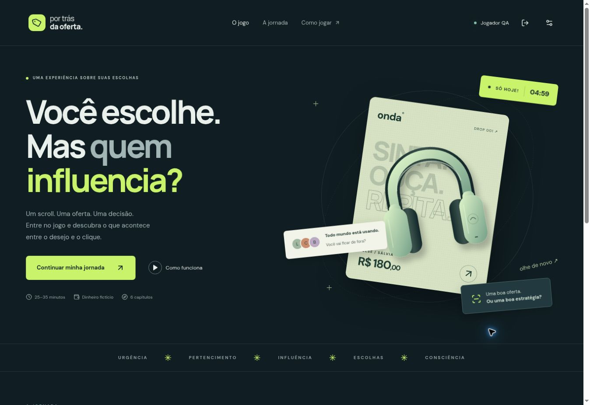

# Por Trás da Oferta

Jogo educativo do Ciclo 4, Colégio Rio Branco. Uma semana de decisões em seis ambientes fictícios de consumo, com R$ 500 de orçamento e R$ 180 de reserva desejada para uma oficina no sábado.

**Demonstração jogável.** Nenhum pagamento real, nenhuma integração silenciosa com o servidor. O progresso fica nesta aba até encerrar a sessão. Este repositório contém exclusivamente o frontend; o backend/MCP permanece em [Por-tras-da-oferta-MCP](https://github.com/benimezz1/Por-tras-da-oferta-MCP).



## Executar

Node.js 22 ou superior e npm:

```sh
npm ci
npm run dev
```

Abra o endereço indicado pelo Vite (normalmente `http://localhost:5173`). Para criar e inspecionar a versão de distribuição:

```sh
npm run build
npm run preview
```

## O que está implementado

1. **Loop / feed:** curtidas que geram recomendações, salvos, perfis, conversa do grupo, detalhes de publicidade e decisão que altera a entrada na loja.
2. **Onda / loja:** busca, dois modelos de fone, preço anterior, histórico, contador reiniciável, disponibilidade, comparação e carrinho com confirmação.
3. **Viva / criadora:** apresentação simulada com quatro trechos, play/pause, navegação por trechos, legendas, patrocínio, comentários e oferta.
4. **Vitrine / avaliações:** filtro de compras verificadas, ordenação, comentários repetidos, critério do ranking, compra da bateria ou alternativa do cabo.
5. **Clube+ / assinatura:** extra pré-selecionado removível, renovação, plano gratuito, percurso de cancelamento e compromisso futuro separado do saldo.
6. **Mercado 21 / desafio final:** kit com múltiplos estímulos, comparação de itens, empréstimo da escola e decisão dependente do saldo restante.

O caderno registra as evidências abertas. O rascunho de reflexão é salvo a cada edição e permanece ao voltar para investigar ou recarregar a mesma aba. Após cada escolha, o jogador conecta técnicas às evidências e explica sua decisão. O resultado apresenta reconhecimento, revisão, escolhas, orçamento e conquistas; permite revisitar os debriefings e exportar JSON. O texto livre é armazenado **sem fingir avaliação semântica por IA**. Comprar ou não comprar não altera o indicador de reconhecimento.

## Validação

```sh
npm test             # domínio, persistência e contrato HTTP, sem navegador
npm run build        # TypeScript estrito + bundle
npx playwright install chromium
npm run test:e2e     # campanha completa, reload/isolamento, teclado, desktop e mobile
```

A CI executa testes, build e Playwright em Chromium com viewports desktop e iPhone 13. Veja o estado da execução no GitHub; testes escritos não equivalem a execução concluída. Evidências e limites de QA: [docs/QA.md](docs/QA.md).

## Estrutura

- `src/game/content.ts`: capítulos, evidências, estratégias e textos educativos.
- `src/game/engine.ts`: máquina de progressão, orçamento em centavos, decisões idempotentes e reconhecimento por evidência.
- `src/game/types.ts`: modelo versionado `c4-v1`.
- `src/components/Scenes.tsx`: seis ambientes exploráveis, com estado de interface isolado por capítulo.
- `src/components/Reflection.tsx`: associação de evidências e justificativa.
- `src/components/Art.tsx`: ilustrações SVG originais.
- `src/services/persistence.ts`: sessão local validada e exportação JSON.
- `src/services/api.ts`: adaptador HTTP dos endpoints realmente existentes.
- `tools/mobile-preview.html`: harness de QA com iframe de 390 × 844; não entra no build de produção.

## Contas e MCP

O padrão é `VITE_BACKEND_ENABLED=false`. Para usar cadastro/login reais, compile com essa variável `true` **somente ao servir a aplicação na mesma origem do backend revisado**. Usa cookie HttpOnly; senhas e tokens não são gravados pelo frontend. Ao restaurar um percurso de conta, `/api/me` deve confirmar a mesma identidade antes de exibir os dados.

A autenticação é compatível com o contrato inspecionado. A nova campanha **ainda não pode ser salva no servidor nem consultada pelo MCP**. Seus cenários não são enviados a `/api/game/choice`, cujo modelo suporta somente quatro escolhas simples. [Contrato observado e API C4 proposta](docs/INTEGRACAO-MCP.md).

## Publicação

O build gera `dist/`. Nenhuma alteração de AWS, Worker, Tunnel ou produção faz parte desta entrega. [Instruções para integração posterior](docs/PUBLICACAO.md).

## Referência e limites

Base: _Relatório Final C3_, capítulos 2–5, especialmente a proposta para C4 nas páginas 15–17. Os exemplos são inventados; não reproduzem dados reais de vendedores. O jogo não diagnostica consumismo, não decide pelo participante e não confunde indício com comprovação de fraude. A apresentação da criadora é uma sequência gráfica legendada, não um vídeo humano gravado. O cartaz e a implementação do assistente ficam fora deste repositório.

As fontes são empacotadas localmente; não há chamadas a Google Fonts, imagens externas, analytics ou IA durante a demonstração. [Créditos e licenças](docs/ATIVOS.md).
